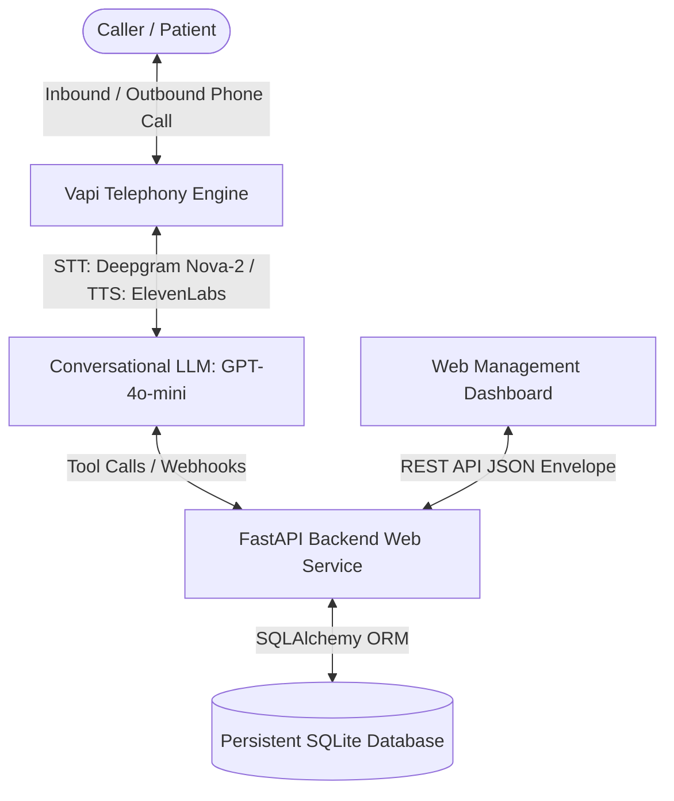

# CareCloud Voice AI Agent — Patient Registration System

A production-grade, voice-driven patient registration system built for the CareCloud Take-Home Assessment. The system enables callers to speak naturally over a real telephone number with an empathetic, human-like voice AI coordinator ("Sarah"), verifies and validates demographic information, checks for duplicates, reads back collected data for explicit confirmation, persists records to a database surviving server restarts, and exposes a REST API accompanied by an interactive web dashboard.

---

## Deliverables Summary

| Item | Details |
| :--- | :--- |
| **Repository URL** | [https://github.com/UmerNoor-cmd/carecloud-voice-agent](https://github.com/UmerNoor-cmd/carecloud-voice-agent) |
| **US Phone Number** | **`+1 (331) 241-4044`** (Provisioned via Vapi Telephony) |
| **API Base URL** | `https://carecloud-voice-agent-ic1k.onrender.com` (or local `http://localhost:8000`) |
| **Dashboard** | `https://carecloud-voice-agent-ic1k.onrender.com/` (or local `http://localhost:8000/`) |
| **API Documentation** | Interactive Swagger UI at `/docs` |
| **Credentials / Notes** | None required. Pre-seeded with 2 demo records (*Jane Doe* & *Carlos Rodriguez*). |

---

## System Architecture

### Separation of Concerns
1. **Telephony & Speech Layer (`Vapi AI`)**:
   - Manages audio streaming, voice activity detection (VAD), interruption handling, speech-to-text (Deepgram Nova-2), and text-to-speech (ElevenLabs "Rachel").
2. **Conversation Orchestration & Prompt Layer (`app/voice/`)**:
   - Prompts designed for concise, conversational voice delivery.
   - Handles multi-turn memory, clarification questions, and Spanish translation ("Hablo español").
   - Function calling tools (`check_existing_patient`, `register_patient`, `update_patient`, `schedule_appointment`).
3. **API & Service Layer (`app/api/`)**:
   - Server-side validation with Pydantic v2.
   - Enforces the `{ "data": {...}, "error": null }` JSON envelope and strict HTTP status codes (200, 201, 400, 404, 422, 500).
4. **Data Persistence Layer (`app/models.py`, `app/database.py`, `app/crud.py`)**:
   - SQLite with WAL (Write-Ahead Logging) and foreign key constraints to ensure database durability across container and server restarts.
   - Supports soft-deletes via `deleted_at`.
5. **Dashboard & Observability (`app/static/`)**:
   - Real-time patient directory, live stats, search/filter by name/DOB/phone, call transcript viewer, appointment scheduler, and an interactive Voice Intake Simulator.

---

## Patient Demographic Data Model

| Field | Type | Required | Validation Rule |
| :--- | :--- | :---: | :--- |
| `patient_id` | UUID | Auto | Auto-generated unique identifier |
| `first_name` | String | **Yes** | 1–50 characters, alphabetic + hyphens/apostrophes |
| `last_name` | String | **Yes** | 1–50 characters, alphabetic + hyphens/apostrophes |
| `date_of_birth` | String/Date | **Yes** | MM/DD/YYYY, valid date, strictly not in future, year >= 1900 |
| `sex` | Enum | **Yes** | Male, Female, Other, Decline to Answer |
| `phone_number` | String | **Yes** | Valid U.S. 10-digit phone number (normalized to `XXX-XXX-XXXX`) |
| `email` | String | No | Valid email format (regex / RFC-compliant) |
| `address_line_1` | String | **Yes** | Street address |
| `address_line_2` | String | No | Apt/Suite/Unit |
| `city` | String | **Yes** | 1–100 characters |
| `state` | String | **Yes** | Valid 2-letter U.S. state abbreviation (all 50 states + DC/territories) |
| `zip_code` | String | **Yes** | 5-digit (`XXXXX`) or ZIP+4 (`XXXXX-XXXX`) |
| `insurance_provider` | String | No | Health insurance company name |
| `insurance_member_id` | String | No | Alphanumeric member / subscriber ID |
| `preferred_language` | String | No | Default: "English" |
| `emergency_contact_name` | String | No | Full name |
| `emergency_contact_phone`| String | No | Valid U.S. 10-digit phone number |
| `created_at` | Timestamp | Auto | UTC creation timestamp |
| `updated_at` | Timestamp | Auto | UTC update timestamp |
| `deleted_at` | Timestamp | Auto | Soft-delete timestamp (null for active patients) |

---

## REST API Specification

All endpoints return a consistent JSON envelope:
- **Success**: `{ "data": <payload>, "error": null }`
- **Error**: `{ "data": null, "error": { "code": "...", "message": "...", "details": [...] } }`

### Endpoints

| Method | Endpoint | Status | Description |
| :--- | :--- | :---: | :--- |
| `GET` | `/patients` | `200` | List patients. Optional filters: `?last_name=`, `?date_of_birth=`, `?phone_number=`, `?include_deleted=true` |
| `GET` | `/patients/{id}` | `200 / 404` | Retrieve a single patient by UUID |
| `POST` | `/patients` | `201 / 422` | Create a new patient record with server-side validation |
| `PUT` | `/patients/{id}` | `200 / 404 / 422` | Partial update of an existing patient |
| `DELETE`| `/patients/{id}` | `200 / 404` | Soft-delete patient (sets `deleted_at`, does not hard-delete) |
| `POST` | `/patients/{id}/restore`| `200 / 404` | Restore a soft-deleted patient |
| `GET` | `/appointments` | `200` | List scheduled appointments (filterable by `?patient_id=`) |
| `POST` | `/appointments` | `201 / 404` | Schedule a patient appointment |
| `GET` | `/calls` | `200` | Retrieve call logs, durations, recordings, and transcripts |
| `POST` | `/api/vapi/webhook` | `200` | Vapi webhook for function/tool calling and end-of-call reporting |
| `GET` | `/health` | `200` | Health check probe |
| `GET` | `/docs` | `200` | Interactive Swagger UI API documentation |

---

## Conversational Design & Prompt Engineering

The voice agent is prompted as **"Sarah"**, an intake coordinator at CareCloud Health Clinic.

### Key Dialogue Principles
1. **Conversational, Not Robotic**:
   - Turns are kept to 1-2 spoken sentences.
   - Natural acknowledgments ("Got it, Jane.", "Thank you.") instead of mechanical menu prompts.
2. **Opt-in for Optional Fields**:
   - Adheres to the prompt requirement: Rather than interrogating callers for every optional field, the agent asks:
     > *"I have your core details. I can also collect your insurance information, emergency contact, or preferred language if you'd like. Would you like to provide any of those today?"*
3. **Mandatory Read-Back Confirmation**:
   - Before invoking the `register_patient` tool, the agent reads back the full demographic details:
     > *"Before I finalize your registration, let me quickly confirm what I have: Name: Jane Doe, born 05/14/1990, 123 Ocean Drive, Miami, Florida 33139, phone 555-234-5678. Does all of that sound correct, or would you like to make any changes?"*
4. **Graceful Correction Handling**:
   - If the caller spells out their name (*"Actually, my last name is spelled D-A-V-I-S, not D-A-V-I-E-S"*), the agent acknowledges and updates immediately without restarting.
5. **Re-prompting on Validation Errors**:
   - If a caller says a future birth year or a 3-digit phone number, the agent specifically re-prompts for that single field with polite guidance.
6. **Graceful Call Completion**:
   - Confirms: *"You're all set, Jane! Your patient registration is complete in our system."* and ends gracefully.

---

## Bonus Challenges Implemented

- [x] **Duplicate Detection**: When caller provides their phone number, the agent calls `check_existing_patient`. If matched, the agent announces: *"It looks like we already have a record for Jane Doe. Would you like to update your information instead?"*
- [x] **Appointment Scheduling**: After registration, the agent offers: *"Would you like me to go ahead and schedule your first primary care appointment as well?"* and records it to the database.
- [x] **Multi-Language Support (Spanish)**: If the caller says *"Hablo español"*, the agent seamlessly transitions to fluent Spanish.
- [x] **Call Recording & Transcript Logging**: Vapi's `end-of-call-report` webhook automatically links the full conversation transcript and audio recording to the patient's record in the database.
- [x] **Interactive Web Dashboard**: A web UI featuring real-time statistics, patient directory, search filters, modal editor, transcript viewer, and a live Voice Intake Simulator.
- [x] **Automated Tests**: Comprehensive Pytest suite covering all REST endpoints, validation errors, duplicate detection, and soft-deletes.

---

## How to Test

### 1. Dial the Live Telephony Agent
- **US Phone Number**: **`+1 (331) 241-4044`**
- Speak naturally to "Sarah" to register a new patient or test duplicate detection by calling from the same number again.

### 2. View Live Dashboard
- Open: [https://carecloud-voice-agent-ic1k.onrender.com](https://carecloud-voice-agent-ic1k.onrender.com) (or local [http://localhost:8000](http://localhost:8000))
